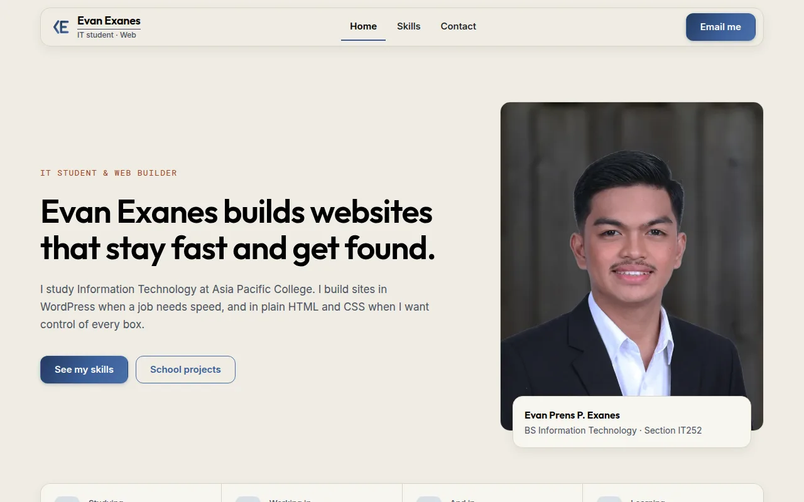

# WEBPROG Activity 2: CSS profile page

**A three-page profile page built with the CSS Box Model and Flexbox only: no Grid, no JavaScript, no media queries.**

## What this shows
- A three-page profile site in HTML and CSS only, with no JavaScript, no Grid and no media queries, as the activity required.
- It uses all three kinds of CSS: external, internal and inline.
- Layouts use Flexbox with `flex-wrap` and `clamp()`.

## Contents
- [What this shows](#what-this-shows)
- [About](#about)
- [What the activity asked for](#what-the-activity-asked-for)
- [Design](#design)
- [Run it](#run-it)
- [License](#license)
- [Author](#author)

## About
A profile page for Evan Exanes, built for Web Programming (WEBPROG) at Asia Pacific College.

| Page | File |
|---|---|
| Home | `index.html` |
| Skills | `skills.html` |
| Contact | `contact.html` |

## What the activity asked for
- **Box Model and Flexbox** on every page. All layouts use `flex-wrap`, `clamp()` and `min-width: 0`.
- **All three types of CSS:** external (`style.css`), internal (the `<style>` block in `skills.html`) and inline (`style` attributes in `index.html` and `contact.html`).
- No Grid, no JavaScript and no media queries.

## Design
The look follows my [portfolio](https://evanexanes.github.io/): a cream canvas, black Outfit headings, hairline rules, soft shadows, and the denim gradient only on the main button, the closing card and the footer.

## Run it
There is no build step. Download the folder and open `index.html` in a browser. Keep `fonts/` and `images/` next to the HTML files, because the pages load them by relative path.

Outfit and Inter are bundled in `fonts/`, both under the SIL Open Font License, so the page makes no network requests.

## License
The code is released under the [MIT License](LICENSE). The portrait in `images/` is a personal photo and is not covered by it.

## Author
**Evan Prens P. Exanes** · [GitHub](https://github.com/evanexanes) · [Portfolio](https://evanexanes.github.io/) · [Contact](https://evanexanes.github.io/07-contact.html)
